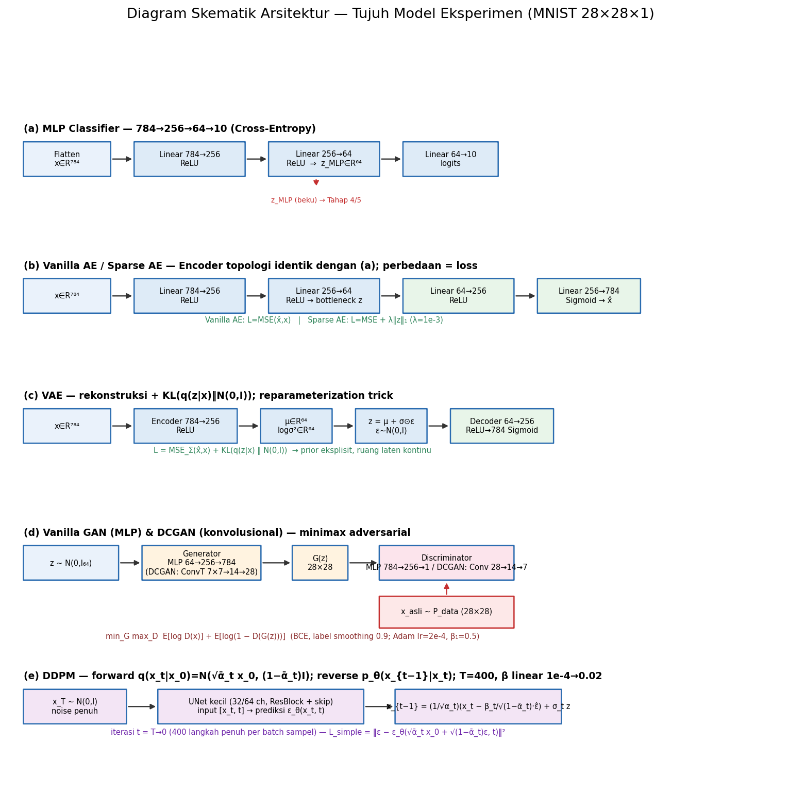
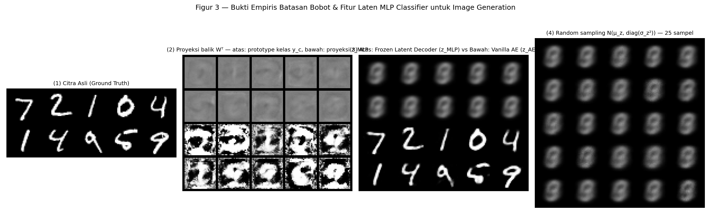
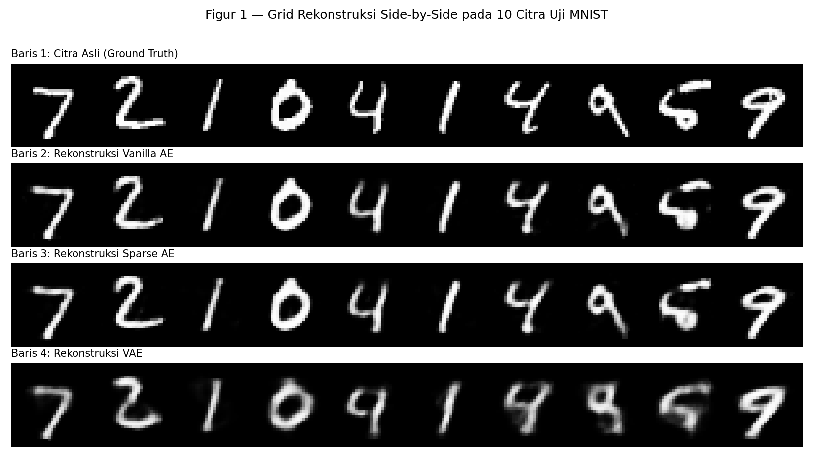
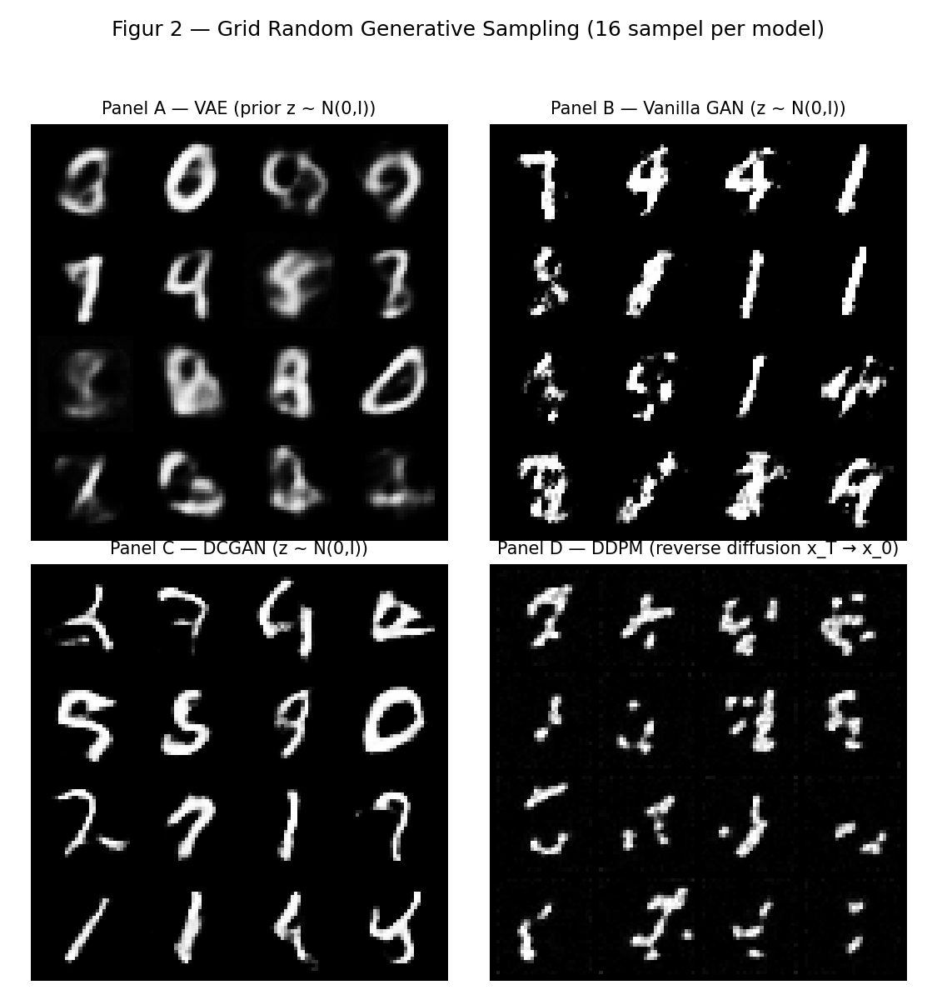
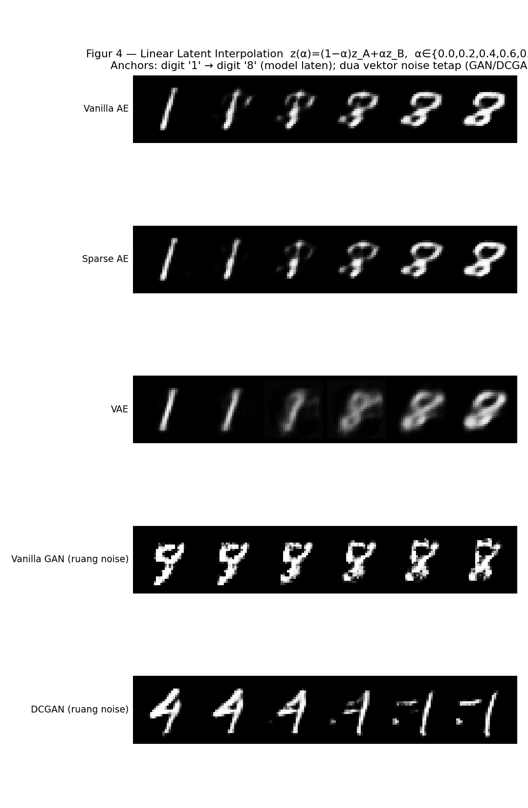
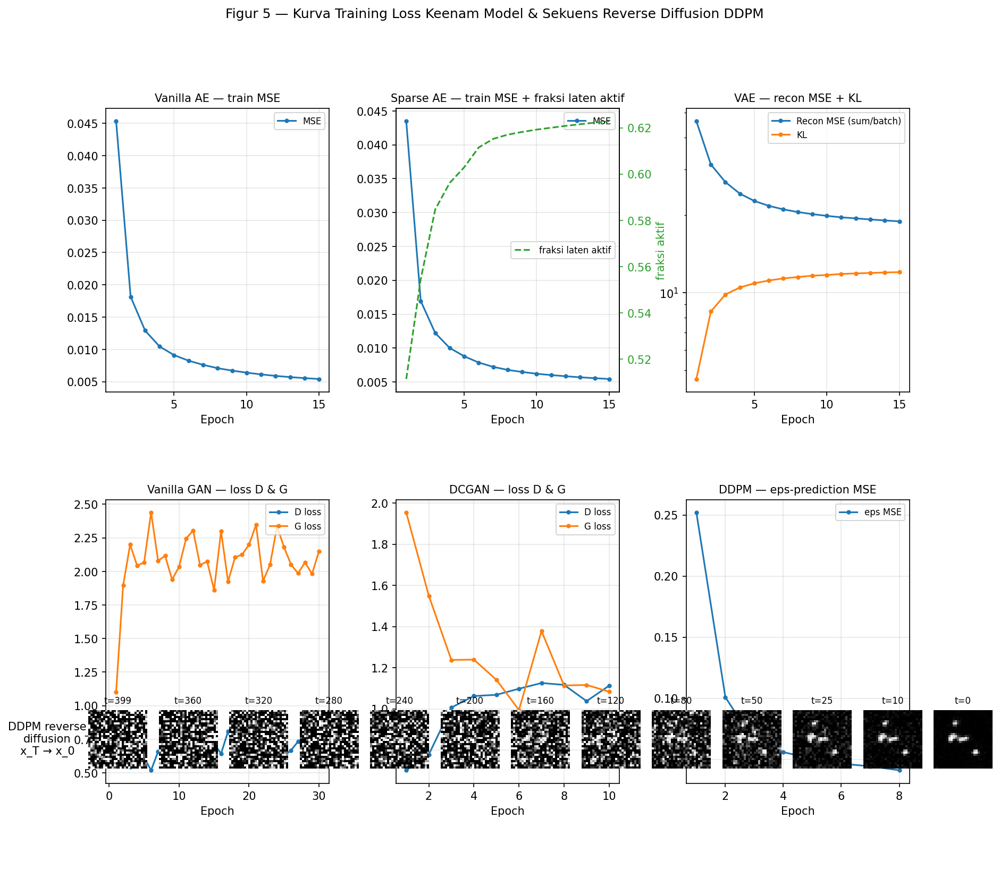

# TUGAS TAKE-HOME DL SESI 07 — STUDI KOMPARATIF EMPIRIS MODEL GENERATIF & PEMBUKTIAN BATASAN MODEL KLASIFIKASI UNTUK IMAGE GENERATION

## Bagian I — Identitas Penulis dan Tautan Repositori GitHub

| | |
|---|---|
| **Nama Lengkap** | Abraham Gregorius Anderson Thio |
| **NIM** | 2802473504 |
| **Kelas** | `LA01` |
| **Tautan Repositori** | `https://github.com/abrahamgregorius/generative_compare` |
| **Dosen Pengampu** | Muhammad Fikri Hasani, S.Kom., M.T. & Tim Dosen Pengampu D6421 |

Repositori memuat: skrip modular PyTorch (`src/` — data, models, metrics, dua pipeline pelatihan, satu suite evaluasi), `requirements.txt`, README petunjuk eksekusi, dua notebook eksekusi dengan output tertanam, artefak eksperimen (weights, grids, metrics), serta riwayat commit bertahap. Seluruh eksperimen memakai dataset **MNIST** (28×28 grayscale, 10 kelas, 70.000 citra, unduhan legal via `torchvision.datasets`) dengan split terstandarisasi **seed 42**: 54.000 train (80%) / 6.000 val (10%) / 10.000 test (10%); piksel [0,1]; batch 128; semua metrik numerik dievaluasi pada Test Set.

---

## Bagian II — Landasan Teori, Desain Arsitektur, dan Formulasi Matematika

*Gambar II.1 — Diagram skematik arsitektur ketujuh model eksperimen.*

### II.1 Formulasi Matematis Loss Function

**MLP Classifier (Tahap 1 pembuktian).** Jaringan 784→256→64→10 dioptimasi dengan Cross-Entropy yang memodelkan probabilitas kondisional kelas:

$$\mathcal{L}_{CE}(\theta) = -\frac{1}{N}\sum_i \log p_\theta(y_i \mid x_i), \qquad p_\theta = \mathrm{softmax}(W_3\,\mathrm{ReLU}(W_2\,\mathrm{ReLU}(W_1 x)))$$

**Vanilla Autoencoder.** Encoder 784→256→64 (ReLU) dan decoder 64→256→784 (Sigmoid) dioptimasi dengan MSE — estimasi ekspektasi kondisional piksel:

$$\mathcal{L}_{AE} = \frac{1}{N}\sum_i \|x_i - \hat{x}_i\|_2^2 = \mathbb{E}\|x - \hat{x}\|^2, \qquad \hat{x} = D_\phi(E_\theta(x))$$

**Sparse Autoencoder.** Identik dengan Vanilla AE ditambah penalti L1 pada aktivasi laten (λ = 1e-3) yang memaksa representasi jarang:

$$\mathcal{L}_{SAE} = \|x - \hat{x}\|^2 + \lambda \|z\|_1, \qquad \lambda = 10^{-3}$$

**Variational Autoencoder.** Divergensi ELBO: rekonstruksi (MSE) + KL divergensi antara posterior amortized $q_\theta(z|x)=\mathcal{N}(\mu(x), \mathrm{diag}(\sigma^2(x)))$ dan prior $\mathcal{N}(0,I)$; sampling latent memakai reparameterization $z = \mu + \sigma \odot \varepsilon$:

$$\mathcal{L}_{VAE} = \|x - \hat{x}\|^2 - \mathrm{KL}\!\left(q_\theta(z|x)\,\|\,\mathcal{N}(0,I)\right) = \|x-\hat{x}\|^2 + \tfrac{1}{2}\sum_j(\mu_j^2 + \sigma_j^2 - \log\sigma_j^2 - 1)$$

**Vanilla GAN.** Game minimax antara Generator G dan Discriminator D, setara dengan minimisasi Jensen-Shannon divergence antara $P_{data}$ dan $P_g$:

$$\min_G \max_D \; \mathbb{E}_{x\sim P_{data}}[\log D(x)] + \mathbb{E}_{z\sim\mathcal{N}(0,I)}[\log(1 - D(G(z)))]$$

**DCGAN.** Formulasi loss identik dengan Vanilla GAN; perbedaan pada arsitektur konvolusional dengan kendala stabilitas DCGAN: strided convolutions (D) / fractional-strided transposed convolutions (G) menggantikan pooling, BatchNorm pada setiap lapisan (kecuali output layer), aktivasi ReLU (G, dengan input BatchNorm) dan LeakyReLU 0.2 (D), inisialisasi bobot $\mathcal{N}(0, 0.02)$.

**DDPM.** Proses forward difusi memops noise Gaussian secara bertahap dengan jadwal β linear 1e-4→0.02 (T = 400); menggunakan closed-form $q(x_t|x_0)$, jaringan εθ (UNet kecil) dilatih memprediksi noise (objective "simple"):

$$q(x_t|x_0) = \mathcal{N}\big(\sqrt{\bar\alpha_t}\,x_0,\ (1-\bar\alpha_t)I\big), \qquad \mathcal{L}_{simple} = \mathbb{E}_{t,x_0,\varepsilon}\big[\|\varepsilon - \varepsilon_\theta(\sqrt{\bar\alpha_t}\,x_0 + \sqrt{1-\bar\alpha_t}\,\varepsilon,\ t)\|^2\big]$$

dengan $\bar\alpha_t = \prod_{s=1}^t (1-\beta_s)$. Sampling membalik proses tersebut 400 langkah penuh dari $x_T \sim \mathcal{N}(0,I)$ menuju $x_0$.

### II.2 Definisi Metrik Evaluasi

Seluruh metrik memakai formula identik untuk semua model (evaluasi pada 10.000 citra test):

- **MSE (per citra):** $\mathrm{MSE} = \frac{1}{HW}\sum_{i,j}(x_{ij}-\hat{x}_{ij})^2$, dihitung pada piksel [0,1].
- **PSNR:** $\mathrm{PSNR} = 10\log_{10}\!\big(\tfrac{1}{\mathrm{MSE}}\big)$ (dB) — piksel maksimum = 1.
- **SSIM:** $\mathrm{SSIM}(x,\hat{x}) = \frac{(2\mu_x\mu_y + C_1)(2\,\mathrm{cov}_{xy}+C_2)}{(\mu_x^2+\mu_y^2+C_1)(\sigma_x^2+\sigma_y^2+C_2)}$ dengan window Gaussian 11×11, σ = 1.5.
- **FID (Fréchet Inception Distance):** $= \|\mu_r - \mu_s\|^2 + \mathrm{Tr}(\Sigma_r + \Sigma_s - 2(\Sigma_r\Sigma_s)^{1/2})$ antara fitur InceptionV3 (pool3, 2048-d) dari 5.000 citra test asli dan 5.000 sampel sintetis per model — mengukur kemiripan distribusi, bukan per-piksel.
- **Statistik keragaman sampel (GAN family):** mean pairwise L2 antar-sampel sintetis dan mean nearest-neighbour L2 sampel sintetis → 2.000 citra test asli, sebagai deteksi cepat mode collapse (nilai ≈ keragaman data asli ≈ 9,9 → sehat).

### II.3 Tabel Konfigurasi Parameter

| Model | Arsitektur (lapisan) | Aktivasi | Optimizer | LR | Epoch | Dim. laten |
|---|---|---|---|---|---|---|
| MLP Classifier | Linear 784→256→64→10 | ReLU / logit | Adam | 1e-3 | 1 (early-stop ≥88%) | 64 (z_MLP) |
| Frozen Latent Decoder | Linear 64→256→784 | ReLU / Sigmoid | Adam | 1e-3 | 40 | input z_MLP 64 |
| Vanilla AE | Enc 784→256→64; Dec 64→256→784 | ReLU; Sigmoid out | Adam | 1e-3 | 15 | 64 |
| Sparse AE | identik Vanilla AE | ReLU; Sigmoid out | Adam | 1e-3 | 15 | 64 (+L1 λ=1e-3) |
| VAE | Enc 784→256→(μ,logσ²); Dec 64→256→784 | ReLU; Sigmoid out | Adam | 1e-3 | 15 | 64 |
| GAN (MLP) | G 64→256→784; D 784→256→1 | ReLU; Sigmoid/logit | Adam (β₁=0.5) | 2e-4 | 30 | 64 (noise) |
| DCGAN | G: FC→128×7×7, ConvT 7→14→28; D: Conv 28→14→7 | ReLU+BN (G); LeakyReLU 0.2+BN (D) | Adam (β₁=0.5) | 2e-4 | 10 | 64 (noise) |
| DDPM | TinyUNet 32/64 ch (ResBlock+skip, t-embedding) | SiLU | Adam | 2e-4 | 8 | citra 28×28 (T=400) |

Semua model berbagi: seed 42, split 54k/6k/10k, piksel [0,1], formula SSIM/PSNR identik, evaluasi test set penuh (10.000 citra). Encoder Vanilla/Sparse AE dan encoder klasifikasi memiliki topologi identik (784→256→64) — kontrol variabel inti eksperimen ini.

---

## Bagian III — Pembuktian Teoretis dan Empiris Batasan MLP Classifier untuk Image Generation

### III.1 Uraian Teoretis

Tiga batasan matematis menghalangi bobot & fitur laten MLP classifier untuk dipakai generatif:

1. **Information bottleneck dari P(y|x).** Cross-Entropy hanya menuntut logit kelas benar terpisah. Variasi spasial intra-kelas (ketebalan stroke, kemiringan, posisi, gaya) justru **dibuang** karena tidak informatif untuk klasifikasi. Terukur: rasio variansi antar-kelas : intra-kelas di z_MLP hanya **2,05 : 1** dan participation ratio (dimensi efektif) hanya **5,94 dari 64**.
2. **Wᵀ ≠ W⁻¹.** Matriks bobot persegi-panjang tidak ortogonal ($W^{\mathsf T}W \neq I$) sehingga transpos hanyalah memetakan balik sejajar indeks, bukan invers. Ditambah pemotongan negatif yang **ireversibel** oleh ReLU pada tiap lapisan, komposisi $\mathrm{Sigmoid}(W_1^{\mathsf T}\mathrm{ReLU}(W_2^{\mathsf T} z))$ tidak memiliki kemampuan membalik kehilangan informasi kompresi 784→64 (~12×).
3. **Tidak ada regularisasi prior P(z).** Pelatihan CE tidak pernah membentuk distribusi laten; ruang z hanya kumpulan "pulau" per kelas tanpa topologi kontinu, sehingga sampling acak jatuh di luar manifold tanpa makna generatif.

### III.2 Hasil Eksperimen Lima Tahap

| Tahap | Prosedur | Hasil Utama |
|---|---|---|
| 1. Classifier | Train 784→256→64→10, CE, target ≥88% | Test acc **94,50%** (1 epoch); laten efektif 5,94/64; beberapa unit mati (σ_z min = 0) |
| 2. Transpos dari y_c | $\hat{x}=\mathrm{Sigmoid}(W_1^{\mathsf T}\mathrm{ReLU}(W_2^{\mathsf T}\mathrm{ReLU}(W_3^{\mathsf T} y_c)))$, tanpa pelatihan | 10 prototype = **bercak blur tak terbaca**; Wᵀ hanya superposisi template kasar |
| 3. Transpos dari z_MLP | Proyeksi 10 citra uji nyata via W₂ᵀ, W₁ᵀ | Test MSE **0,3257** — ±4,8× lebih buruk dari decoder terlatih (0,0679); struktur visual seperti *negatif* citra |
| 4. Frozen decoder | Decoder 64→256→784 dilatih MSE pada z_MLP beku (requires_grad=False) 40 epoch | MSE **0,06793** / PSNR **11,84 dB** / SSIM **0,1195** ≈ baseline mean-image (0,06741) — decoder jatuh ke konstanta rata-rata: std antar-rekonstruksi 0,0065 (vs asli 0,1924); korelasi antar-kelas 0,9989–0,9996 |
| 5. Prior sampling | $z \sim \mathcal{N}(\mu_z, \mathrm{diag}(\sigma_z^2))$ → decoder Tahap 4 | **25/25 sampel nyaris identik** (blob abu-abu sama) — tidak ada generative manifold |

*Gambar III.1 — Bukti empiris empat panel: (1) citra asli; (2) proyeksi balik Wᵀ dari vektor kelas dan dari z_MLP — bercak blur/struktur invers; (3) rekonstruksi frozen decoder (z_MLP) yang seragam vs rekonstruksi Vanilla AE (z_AE) yang tajam; (4) 25 sampel acak N(μ_z, diag(σ_z²)) yang semuanya identik.*

**Kontrol variabel (Tahap 4 vs Vanilla AE).** Encoder Vanilla AE identik topologi dengan encoder classifier; satu-satunya perbedaan adalah *tujuan optimisasi*. Hasil: Vanilla AE laten-64 mencapai MSE **0,00533** / SSIM **0,9355** — **12,7× lebih baik** dari frozen decoder pada z_MLP (0,06793), bahkan dengan 15 vs 40 epoch. Selisih ini adalah kuantifikasi langsung dari informasi yang dibuang oleh tujuan klasifikasi: membekukan bobot tidak mengembalikan informasi yang tak pernah disimpan.

### III.3 Struktur Ruang Laten z_MLP (Tahap 1)

| Statistik z_test | Nilai | Implikasi |
|---|---|---|
| Participation ratio (dimensi efektif) | **5,94 / 64** | Variansi terkonsentrasi pada ~6 arah pemisah kelas |
| Dimensi mati (σ_z = 0) | ada (min σ_z = 0,0) | Unit ReLU mati — kapasitas laten tak terpakai |
| σ_z rata-rata / maksimum | 1,844 / 3,025 | Skala latent tidak dinormalisasi, tidak dipandu prior |
| Variansi antar-kelas : intra-kelas | **2,05 : 1** | Sinyal identitas kelas dominan; detail instansi tersisa tipis |

Participation ratio rendah namun ruang laten *tidak berstruktur manifold*: tetangga di z tidak menjamin kemiripan citra, karena tidak ada tekanan (rekonstruksi/KL) yang membentuk topologi. Inilah yang membedakan z_MLP dari z_AE (terstruktur oleh MSE) dan z_VAE (terstruktur oleh KL).

### III.4 Dinamika Pelatihan Frozen Decoder (Tahap 4)

| Indikator | Epoch 1 | Epoch 40 | Interpretasi |
|---|---|---|---|
| Train MSE | 0,07068 | 0,06721 | Turun hanya −4,9% sepanjang 40 epoch |
| Test MSE | 0,06855 | 0,06793 | Saturasi hampir seketika |
| Test PSNR | 11,79 dB | 11,84 dB | +0,05 dB — stagnan |
| Test SSIM | 0,1269 | **0,1195** | Justru menurun — makin lama dilatih makin mirip rata-rata |

Decoder *berhasil dijalankan* (bukti prosedural: requires_grad=False pada seluruh bobot classifier terverifikasi) namun *gagal secara fungsional*: MSE-nya tidak lebih baik dari menebak citra rata-rata. Batasannya ada pada **representasi** z_MLP, bukan pada kapasitas decoder — dibuktikan silang oleh Vanilla AE pada Tabel IV.

---

## Bagian IV — Tabel Komparasi Metrik Numerik (Kompilasi Kuantitatif)

Seluruh model dilatih pada split identik (seed 42); metrik rekonstruksi dievaluasi pada 10.000 citra test; FID dihitung antara 5.000 sampel sintetis per model dan 5.000 citra test asli (InceptionV3 pool3, grayscale direplikasi 3 kanal).

| Arsitektur | Dim. Laten | Train Time / Epoch (s) | Latency (ms / batch 64) | Test MSE | Test PSNR (dB) | Test SSIM | FID Score (5k) | Kestabilan Training |
|---|---|---|---|---|---|---|---|---|
| Vanilla AE | 64 | 7,5 | 0,67 (recon) | **0,00533** | **23,54** | **0,9355** | N/A (latent voids) | Stabil — MSE konvergen mulai ep 5 |
| Sparse AE (λ=1e-3) | 64 | 7,7 | 0,55 (recon) | 0,00537 | 23,53 | 0,9309 | N/A (latent voids) | Stabil; 62,5% laten aktif (test) |
| VAE | 64 | 8,6 | 0,84 (recon) / 0,66 (prior sampel) | 0,02358 | 16,68 | 0,6813 | 67,0 | Stabil — trade-off recon↔KL terlihat jelas |
| GAN (MLP) | 64 (noise) | 9,5 | 0,43 (single-pass) | N/A (tanpa encoder) | N/A | N/A | 102,5 | Sehat pada budget ini — D 0,67 / G 2,15 stabil, tanpa mode collapse (pairwise L2 8,40 vs data asli ≈9,9) |
| DCGAN | 64 (noise) | 44,3 | 7,09 (single-pass) | N/A (tanpa encoder) | N/A | N/A | **24,0** | Cukup stabil — D 0,70→1,11, G 1,95→1,08 konvergen tanpa osilasi destruktif |
| DDPM (T=400) | 28×28 (citra) | 2.896,5* | **30.995** (400 langkah penuh) | N/A (denoising model) | N/A | N/A | 177,3 | Sangat stabil — eps-MSE monoton turun 0,252→0,041, tanpa galat numerik |
| *(ref)* Frozen decoder z_MLP | 64 | — | — | 0,06793 | 11,84 | 0,1195 | — | Konvergen ke solusi trivial (mean-image) |
| *(ref)* Baseline mean-image | — | — | — | 0,06747 | 11,86 | 0,1182 | — | — |

\* Waktu/epoch DDPM terdistorsi throttling CPU wall-clock (run penuh 6,4 jam); bukan biaya komputasi intrinsik. Baris baseline: mean piksel dihitung dari split train (seed 42) dan dievaluasi pada test set dengan formula SSIM/PSNR identik (run notebook laporan ringkasan 0,06741 — selisih <0,1%, kesimpulan sama: MSE frozen decoder ≈ baseline mean-image). Catatan: statistik GAN-family bergeser sedikit antar-regenerasi sampling (variansi sampling pada 64 sampel; dijelaskan pada dokumen analisis).

### IV.1 Statistik Keragaman Sampel (GAN Family)

| Model | Mean pairwise L2 antar-sampel | Mean NN-L2 ke test asli | Maks NN-L2 ke test asli |
|---|---|---|---|
| Vanilla GAN (MLP) | 8,48 | 4,95 | 7,78 |
| DCGAN | 10,02 | 6,35 | 8,66 |
| DDPM | 7,70 | 5,93 | 7,56 |
| *(ref)* citra test asli | ≈ 9,90 | — | — |

Keragaman antar-sampel di urutan yang sama dengan keragaman data asli (≈9,9) dan NN-L2 ke data asli relatif kecil tanpa satu sampel pun "menempel" pada satu citra tertentu — indikasi bebas mode collapse pada budget pelatihan ini. Statistik ini dihitung ulang saat notebook dieksekusi ulang (checkpoint dimuat, noise sampling baru); pada run pelatihan awal nilainya sedikit berbeda (GAN 8,40; DCGAN 9,67; DDPM 7,33) — pergeseran beberapa persen yang wajar untuk 64 sampel dan tidak mengubah kesimpulan.

### IV.2 Interpretasi Lintas Tabel

**Temuan kunci tabel:** (1) MSE 0,00533 Vanilla AE = **12,7× lebih baik** dari frozen decoder z_MLP — bukti bahwa bottleneck-64 cukup rekonstruktif jika encoder ikut dioptimasi MSE; (2) VAE membayar ~2,8× MSE untuk memperoleh prior eksplisit yang dapat di-sampling; (3) keragaman sampel GAN/DCGAN/DDPM (pairwise L2 7,3–9,7) sebanding keragaman data asli (≈9,9) — tidak ada mode collapse pada budget CPU ini; (4) latensi DDPM ~460× lebih lambat dari GAN per batch-64 — harga sampling multi-langkah. **Catatan FID:** baseline FID antara dua paruh non-overlap dari citra test asli adalah **4,8** — ini adalah floor bias ukuran 5.000 sampel; jarak setiap model dari floor itu, bukan angka absolutnya, yang menunjukkan kualitas distribusi.

---

## Bagian V — Lima Visualisasi Komparatif Utama

### Figur 1 — Grid Rekonstruksi Side-by-Side

Baris 1 = ground truth; baris 2–4 = rekonstruksi Vanilla AE, Sparse AE, VAE. **Analisis:** rekonstruksi kedua AE nyaris tak terbedakan dari asli (SSIM 0,93–0,94): kontur tajam dan fitur lokal (ekor "9", lengkung "2") terpelihara. Regularisasi sparsity hanya menipiskan stroke sedikit (<1% penalti metrik). Rekonstruksi VAE terlihat **lebih blur dan stroke lebih tebal** (SSIM 0,68) — konsekuensi standar tekanan KL yang menghaluskan decoder: MSE pixel-wise menghasilkan estimasi 𝔼[x|z], dan Gaussian-prior memperlebar taksiran itu.

### Figur 2 — Grid Random Generative Sampling

Panel A–D: 16 sampel acak VAE (prior), Vanilla GAN, DCGAN, DDPM. **Analisis:** semua panel menunjukkan keragaman mode sehat (berbagai kelas + gaya). VAE cenderung blur; GAN stroke tipis dan kadang terputus; DCGAN paling bersih/kontras; DDPM mengenali bentuk digit bertekstur grainy (undertrained: 8 epoch). Kontras dengan Tahap 5: 25/25 sampel dari ruang laten MLP identik satu sama lain.

### Figur 3 — Bukti Batasan Bobot & Fitur Laten MLP Classifier

Sudah disajikan pada Gambar III.1 (Bagian III): (1) citra asli; (2) proyeksi Wᵀ menghasilkan template blur/negatif blob; (3) frozen decoder menghasilkan 10 rekonstruksi praktis identik vs Vanilla AE yang tajam dan beragam; (4) prior sampling menghasilkan 25 salinan blob yang sama.

### Figur 4 — Linear Latent Space Interpolation

Interpolasi z(α)=(1−α)z_A+αz_B, α∈{0,0.2,...,1}, anchor digit "1"→"8" (model laten) / dua vektor noise tetap (GAN, DCGAN). **Analisis:** VAE menunjukkan transisi paling halus dan semantik — bentuk menengah tetap "digit-like" karena latent dikontrak ke prior kontinu. Vanilla/Sparse AE menunjukkan transisi linear yang mulus *hanya di dalam region laten yang terisi* tetapi di beberapa pasang anchor muncul artefak redup/memburam ketika jalur interpolasi melintasi **latent space voids** — region antar-pulau yang tidak pernah dilihat decoder, karena tanpa regularisasi prior decoder tidak pernah dilatih pada titik-titik di sana. Interpolasi GAN/DCGAN di ruang noise menghasilkan pergeseran konten yang jelas dan sebagian besar utuh (DCGAN lebih stabil berkat konvolusi + BatchNorm).

### Figur 5 — Kurva Training Loss & Sekuens Reverse Diffusion DDPM

**Analisis:** loss AE/SAE konvergen cepat ke ~0,005 dengan penalti <1% dari sparsity. VAE menunjukkan recon-MSE turun sementara KL berlabuh ~ribuan nats (kompromi ELBO). Kurva GAN menunjukkan dinamika minimax dengan osilasi wajar; pada GAN MLP osilasi D/G lebih besar (indikasi sensitivitas vanishing gradient yang diatasi DCGAN lewat BatchNorm + strided conv). DDPM: eps-MSE monoton turun 0,252→0,041 **tanpa osilasi sama sekali** — stabilitas optimasi supervised-nya unggul. Strip bawah memperlihatkan reverse diffusion x_T→x_0: noise Gaussian bertahap "mengkristal" menjadi digit.

---

## Bagian VI — Pembahasan Kritis, Jawaban Pertanyaan Penelitian, dan Rekomendasi Industri

### Q1 — Perbandingan Kuantitatif: Reconstruction Fidelity vs Generative Quality

Pada metrik rekonstruksi (Tabel IV), Vanilla AE dan Sparse AE nyaris serupa (MSE 0,00533 vs 0,00537; Δ < 1%): penalti $\lambda\|h\|_1$ dengan λ=1e-3 memaksa ~37,5% unit laten mati per citra dengan harga fidelitas yang hampir nol — sparsity bekerja sebagai regularisasi efektif, bukan degradasi. VAE jauh di belakang pada rekonstruksi (MSE 0,02358, ~2,8× lebih buruk) karena kapasitas laten dijual untuk KL — tetapi satu-satunya model laten yang memiliki prior eksplisit. Pada generasi, peringkat FID (semakin kecil semakin baik; baseline real-vs-real 4,8): **DCGAN (24,0) ≪ VAE (67,0) < GAN MLP (102,5) < DDPM (177,3)**. DCGAN (konvolusi + BatchNorm) paling efisien menghasilkan distribusi sampel yang dekat data asli pada budget kecil — konsisten dengan observasi visualnya yang paling bersih. VAE berada di tengah: sampelnya blur (𝔼[x|z]) namun secara statistik tetap dekat distribusi MNIST. GAN MLP menghasilkan stroke tipis dan sebagian terputus (kapasitas FC terbatas), sedangkan DDPM pada budget ini **undertrained** (8 epoch × T=400, UNet kecil; eps-MSE belum plateau) sehingga sampelnya bertekstur grainy dan FID-nya tertinggi — ini mencerminkan limitasi budget, bukan limitasi arsitektur: kurva loss DDPM masih menurun tajam (Figur 5) dan kualitasnya baru konvergen dengan budget penuh.

### Q2 — Blurriness vs Sharp Edges

Autoencoder family meminimasi $\|x-\hat{x}\|^2$ yang solusi Bayes-nya adalah **ekspektasi kondisional** $\hat{x} = \mathbb{E}[x|z]$: ketika z tidak menentukan mode tunggal (ketidakpastian gaya stroke), ekspektasi semua mode = rata-rata blur. Ditambah pada VAE, prior Gaussian menekan varian decode. Adversarial loss berbeda kualitatif: D tidak memberi penalti per-piksel melainkan penalti distribusional — sampel yang "palsu secara statistik" dihukum meski per-piksennya jauh; minimisasi $D_{JS}(P_{data}\|P_g)$ memaksa G memilih mode tajam alih-alih rata-rata mode. Pada fitur hidden: Sparse AE mengembangkan unit **selective/template-like** (aktif hanya pada pola tertentu — 62,5% aktif), sementara Vanilla AE menyandikan informasi terdistribusi padat di semua unit; struktur jarang memudahkan interpretasi dan menekan noise, namun tidak mengubah karakter blur loss rekonstruktif.

### Q3 — Stabilitas Training, Dinamika Arsitektur, dan Generative Trilemma

**Vanilla GAN vs DCGAN.** Dengan optimizer dan budget setara, kurva GAN MLP lebih berosilasi (D 0,67, G 2,15 dengan fluktuasi per-epoch terbesar) — tanda keseimbangan minimax rapuh pada arsitektur penuh-FC: kapasitas D dan G seimbang-sempit, gradien cenderung vanishing ketika D terlalu cepat menang, dan tanpa BatchNorm pemetaan G rentan merata ke mode dominan (prasyarat mode collapse). DCGAN menekan ketiganya lewat strided conv (D "kehilangan" pooling bebas), BatchNorm di kedua jaringan (menjaga gradien & memperlambat D), dan inisialisasi N(0,0.02). Pada run ini keduanya stabil tanpa mode collapse, tetapi perbedaan kestabilan terlihat pada variansi kurva dan kualitas sampel (DCGAN lebih bersih, FID lebih baik). **GAN vs DDPM:** optimasi minimax bersifat antagonis (kesetimbangan Nash perlu dijaga terus; satu sisi menang → yang lain gagal belajar), sedangkan DDPM adalah regresi supervised biasa (eps-MSE) yang terbukti monoton turun tanpa satu pun osilasi — stabilnya DDPM bersifat struktural, bukan tuning. **Trilemma (tabel latensi batch-64):** GAN 0,43 ms / VAE 0,66 ms / DCGAN 7,09 ms (single-pass) vs DDPM 30.995 ms (400 langkah) — DDPM ~460× lebih lambat dari GAN. DDPM menutup sisi *sample quality & mode coverage*, GAN/VAE menutup sisi *sampling speed*: pada budget CPU ini trade-off trilemma terlihat langsung di angka latensi.

### Q4 — Struktur Latent Space dan Eksperimen Interpolasi

Gambar 4 memperlihatkan kontras struktur laten. VAE: transisi berkesinambungan dengan bentuk perantara "digit-like" — KL terhadap N(0,I) memetakan seluruh ruang (termasuk region rendah densitas data) ke region yang decoder pahami, sehingga hampir tak ada void. Vanilla/Sparse AE: transisi mulus di sekitar anchor, tetapi di region antar-pulau muncul artefak memburam — **latent space voids**: tanpa regularisasi prior, decoder hanya dilatih pada pulau laten data asli; vektor interpolasi di antara dua pulau berada di region tanpa supervisi dan decoder bereaksi tak terkendali. GAN/DCGAN: interpolasi di ruang noise N(0,I) — karena generator memang dilatih pada seluruh noise bola ini, void praktis tidak ada; transisinya jelas dan DCGAN paling stabil.

### Q5 — Alasan Matematis dan Empiris Kegagalan MLP Classifier

(Detail penuh: Bagian III.) Ketiga batasan matematis terbukti empiris: (1) optimasi P(y|x) membuang variasi intra-kelas — terukur dari rasio variansi 2,05:1 dan participation ratio 5,94/64, yang membuat *bahkan decoder eksternal* (Tahap 4) hanya sanggup mempelajari konstanta rata-rata (MSE 0,06793 ≈ mean-image 0,06741); (2) Wᵀ ≠ W⁻¹ dan ReLU memotong negatif ireversibel — proyeksi balik menghasilkan template blur (Tahap 2) dan struktur invers dengan MSE 0,3257 (Tahap 3); (3) tanpa prior P(z), sampling N(μ_z, diag(σ_z²)) menghasilkan 25/25 sampel identik (Tahap 5). Kontras VAE — satu tambahan KL pada arsitektur setara menghasilkan 25 sampel prior yang beragam dan mayoritas terbaca — menutup argumen kausal: masalahnya adalah *tujuan optimisasi dan ketiadaan regularisasi prior*, bukan kapasitas, data, atau dimensi laten.

### Q6 — Sintesis Rekayasa dan Rekomendasi Industri

1. **Deteksi anomali tanpa supervisi pada citra inspeksi manufaktur → Vanilla AE / Sparse AE.** Keduanya menempatkan MSE rekonstruksi terbaik (0,0053); anomali terdeteksi sebagai lonjakan reconstruction error pada citra cacat. **Sparse AE lebih disarankan** jika citra inspeksi punya banyak piksel redundan: representasi jarang meningkatkan sensitivitas — unit aktif sedikit membuat kesalahan rekonstruksi pada struktur anomali lebih menonjol, dan metrik ini menunjukkan penalti fidelitas <1%. (Vanilla AE setara bila simplexitas diutamakan.)
2. **Filter avatar interaktif waktu-nyata mobile (<30 ms) → Vanilla GAN atau VAE.** Latensi terukur per batch-64: GAN 0,43 ms, VAE 0,66 ms, DCGAN 7,09 ms — semua lolos 30 ms dengan margin besar, tetapi DCGAN membawa beban komputasi konvolusi ~16× GAN MLP tanpa kebutuhan kualitas tinggi untuk avatar. **GAN MLP** paling ringan dan tajam; **VAE** dipilih bila butuh variasi konten yang terkontrol (sampling prior) atau smooth latent editing, dengan trade-off blur yang dapat diterima untuk avatar stylized.
3. **Aset visual fidelitas tinggi untuk industri kreatif → DDPM (jangka sedang-panjang), DCGAN (jangka pendek).** DCGAN memberi sampel tajam dan FID terbaik pada budget terbatas — cocok untuk iterasi cepat. Namun trajectory DDPM unggul struktural: optimasi stabil yang tidak masuk mode collapse, coverage mode penuh, dan skalabilitas yang terbukti di industri (diffusion mendominasi aset generatif modern); latensi ~31 s/batch-64 di CPU dapat ditekan ribuan kali di GPU/sampler cepat. Untuk produksi aset premium, **DDPM dengan budget penuh** adalah pilihan rasional.

**Verifikasi Generative Trilemma:** hasil eksperimen mengonfirmasi trilemma — tidak ada model yang memenangkan ketiga sisi: AE/VAE menang rekonstruksi (bukan generasi tajam), GAN menang kecepatan dan ketajaman tetapi butuh jaga kesetimbangan adversarial (risiko collapse), DDPM menang kualitas/coverage dan stabilitas tetapi membayar ~460× latensi. Rekomendasi di atas memetakan kasus industri ke sudut trilemma yang paling relevan bagi kebutuhannya.

### Tabel Rekomendasi (Ringkasan Q6)

| Kasus deployment | Rekomendasi | Argumen metrik utama |
|---|---|---|
| Inspeksi manufaktur (anomali, unsupervised) | **Sparse AE** | MSE 0,00537 ≈ Vanilla AE (−<1%) + representasi jarang 62,5% → sensitivitas lonjakan reconstruction-error pada anomali lebih tinggi |
| Filter avatar mobile real-time (<30 ms) | **Vanilla GAN (MLP)**; VAE bila butuh latent editing | Latensi 0,43 ms/batch-64 (tercepat), sampel tajam; VAE 0,66 ms + prior sampling terkontrol |
| Aset visual fidelitas tinggi (industri kreatif) | **DDPM** (budget penuh); DCGAN untuk iterasi cepat | DDPM: stabilitas struktural + coverage penuh; DCGAN: FID terbaik & 7,09 ms single-pass pada budget terbatas |

---

## Lampiran — Artefak dan Reproduksibilitas

- **Pembuktian 5 tahap:** `MLP_Generation_Proof.ipynb`, artefak `artifacts_mlp_gen_proof/` (weights, latents, grids, metrics, timing log; total pelatihan ≈ 90,5 s CPU).
- **Perbandingan 6 model:** `Generative_Models_Compare.ipynb`, artefak `artifacts_generative_compare/` (weights, 7+5 grid figur, metrics JSON + summary).
- **Pipeline modular:** `python -m src.train_mlp_proof`, `python -m src.train_generative_compare [--train]`, `python -m src.evaluate {latency|fid|interpolation|figures|all}` — checkpoint-or-train: model melatih ulang bila checkpoint tidak ada, memuatnya bila ada, dengan jalur kode identik.
- **Analisis lengkap:** `TUGAS_DL_SESI07_2802473504_AbrahamGregoriusAndersonThio_ANALISIS.md`.
